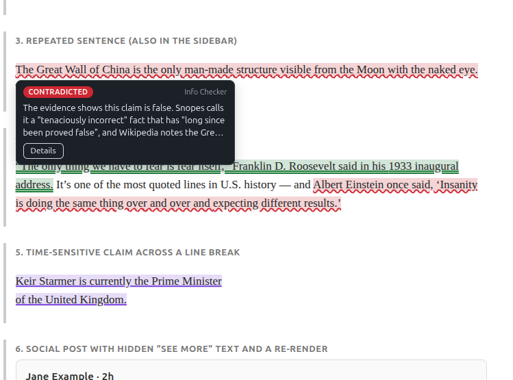
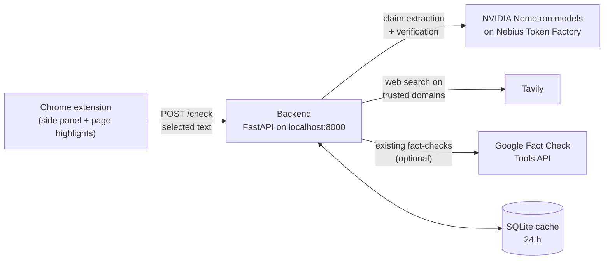
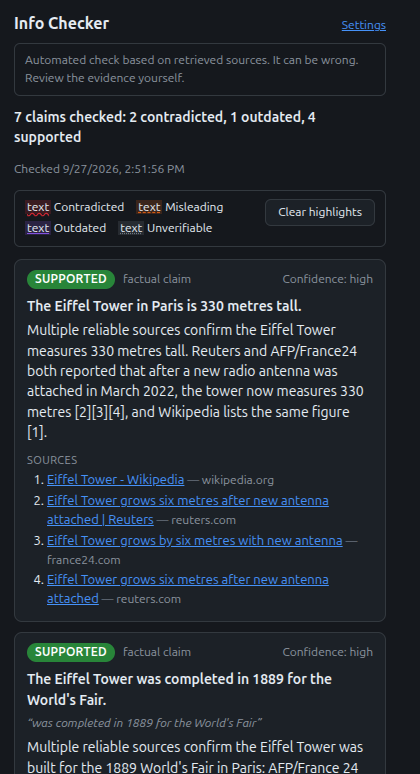

# Info Checker

A Chrome extension and Python backend for fact-checking text you select on any web page.
Select a passage, right-click **Fact-check this**, and a side panel lists each factual
claim with a verdict, a short explanation, a confidence level, and links to the sources
it was checked against. The claims are also highlighted on the page.



> **Automated check based on retrieved sources. It can be wrong. Review the evidence
> yourself.** Verdicts come from a language model reading search results. They are a
> starting point for your own judgment, not a ruling.

## What it does and doesn't do

**It does:**
- Split the selected text into individual claims (up to 8), and label opinions and
  predictions as *not checkable*.
- Search a list of trusted sites (wire services, fact-checkers, major outlets, official
  sources) that you control in [`backend/sources.yaml`](backend/sources.yaml).
- Ask a language model to judge each claim **only against the retrieved evidence**, with
  numbered citations. For every citation the model must also copy an exact quote from
  the cited item. Code checks each quote against that item's text:
  - A citation whose quote is found only in a different item is moved to that item.
  - A citation with no matching quote is dropped.
  - A verdict left with no valid citation is downgraded to *unverifiable*.
- Work in other languages. Claims are searched in English and in the text's own
  language, and explanations are written in the language of the selected text.
- Highlight each claim on the page by verdict, without changing the page's HTML.

**It doesn't:**
- Read or scrape pages on its own. It only processes text **you select** and explicitly
  send, and it doesn't scan feeds. The extension injects its script only into the tab
  where you clicked **Fact-check this**.
- Keep API keys in the browser. All API calls happen in the backend, on your machine.
- Check images or videos, or know about events newer than what the search index has.

## How it works



1. The extension captures your selection and sends its text to the backend.
2. The backend asks an LLM (NVIDIA Nemotron-3 Super by default) to split it into
   self-contained claims, each typed as factual, quote, opinion or prediction.
3. For each factual claim or quote, it searches Tavily (limited to `sources.yaml`) and,
   if configured, the Google Fact Check API. Claims about current events also get a
   news search, which returns dated articles.
4. A second LLM call (NVIDIA Nemotron-3 Ultra by default) judges each claim against the
   numbered evidence. It returns one of *supported*, *contradicted*, *misleading*,
   *outdated* or *unverifiable*, with a supporting quote for each citation, which the
   code then checks.
5. The extension shows a card per claim and highlights each claim's text on the page.



## Requirements

- Python 3.11 or newer
- Google Chrome (or another Chromium browser with side panel support, version 114+)
- API keys:

| Service | Used for | Get a key | Required |
|---|---|---|---|
| [Nebius Token Factory](https://tokenfactory.nebius.com) | LLM calls to NVIDIA Nemotron (OpenAI-compatible API) | Sign in → API keys → create | yes |
| [Tavily](https://app.tavily.com) | Web search (free tier available) | Sign up → API keys | yes |
| [Google Fact Check Tools API](https://developers.google.com/fact-check/tools/api) | Existing fact-checks | Google Cloud Console → enable *Fact Check Tools API* → Credentials → *Create API key* | no |

## Setup

### 1. Store the API keys

Each key goes in its own file containing only the key, outside the repository:

```bash
mkdir -p ~/.config/info_checker
printf '%s' 'YOUR_NEBIUS_KEY' > ~/.config/info_checker/key_nebius.txt
printf '%s' 'YOUR_TAVILY_KEY' > ~/.config/info_checker/key_tavily.txt
# optional:
printf '%s' 'YOUR_GOOGLE_KEY' > ~/.config/info_checker/key_google_factcheck.txt
chmod 600 ~/.config/info_checker/key_*.txt
```

The backend reads the keys from these files (`~` is expanded). It never logs them or puts
them in error messages. It warns at startup if a key file is readable by other users.
You can instead set `NEBIUS_API_KEY=...` directly, but not both forms for the same key.

### 2. Install and configure the backend

```bash
cd backend
python3 -m venv .venv
.venv/bin/pip install -e '.[dev]'
cp .env.example .env
```

`backend/.env` holds settings and key-file **paths**, never key values. The defaults
point to `~/.config/info_checker/`. If you created the Google key file, uncomment
`GOOGLE_FACTCHECK_API_KEY_FILE`.

Optional: see which models your Nebius account offers, and change `EXTRACTION_MODEL` and
`VERIFICATION_MODEL` in `.env`:

```bash
.venv/bin/python scripts/list_models.py          # all models
.venv/bin/python scripts/list_models.py nemotron # filter by name
```

The defaults are NVIDIA Nemotron models:

| Setting | Default | Why |
|---|---|---|
| `EXTRACTION_MODEL` | `nvidia/nemotron-3-super-120b-a12b` | 6/6 correct on the extraction test: valid JSON first try, exact spans, right claim types. Median about 10s. Nano was also correct but slower and much less predictable (10–50s) |
| `VERIFICATION_MODEL` | `nvidia/Nemotron-3-Ultra-550b-a55b` | The largest Nemotron. Grounded verdicts; good with non-English text |

Tested alternatives that also work: `deepseek-ai/DeepSeek-V4-Pro` (extraction),
`zai-org/GLM-5.3` (verification), `Qwen/Qwen3-235B-A22B-Instruct-2507` (either). The
Nemotron-3 models reason internally before answering. That costs extra output tokens,
and the reasoning text never shows up in the result.

### 3. Run the backend

```bash
cd backend
.venv/bin/uvicorn app.main:app --host 127.0.0.1 --port 8000
```

Startup fails with a clear message if a key or model is missing. Check it's up:
`curl http://127.0.0.1:8000/health`.

### 4. Load the extension

1. Open `chrome://extensions` and turn on **Developer mode** (top right).
2. Click **Load unpacked** and choose the `extension/` folder.
3. Copy the extension's **ID** from its card (32 lowercase letters).
4. Put it in `backend/.env` and restart the backend:
   ```
   ALLOWED_ORIGINS=chrome-extension://YOUR_EXTENSION_ID
   ```
   The ID stays the same as long as you load the extension from the same folder.
5. On any page, select some text, right-click, and choose **Fact-check this**.

If the backend runs somewhere other than `http://localhost:8000`, open the extension's
**Settings** (link in the side panel), enter the URL, and click **Save**. Chrome asks you
to allow the new address. **Test connection** calls `/health`.

## Using it

- **Side panel.** Shows a summary line, then one card per claim: a verdict badge, the
  claim, the explanation with numbered citations, the confidence, and source links.
  Clicking a card scrolls the page to that claim and flashes it.
- **Highlights on the page:**

  | Verdict | Highlight |
  |---|---|
  | Contradicted | red, wavy underline |
  | Misleading | orange, dashed underline |
  | Outdated | purple, solid underline |
  | Unverifiable | gray, dotted underline |
  | Supported | green, double underline. Off by default; turn on in Settings |
  | Not checkable | never highlighted |

  Hover a highlight for a tooltip; **Details** jumps to the claim's card. **Clear
  highlights** removes them. A new check on the same page replaces the old highlights.
- **Card notes:**
  - *"Couldn't locate this text on the page"*: the claim's wording wasn't found in
    your selection, and the extension doesn't guess.
  - *"No longer visible on the page"*: the page removed or re-rendered that text.
- Highlighting uses the [CSS Custom Highlight API](https://developer.mozilla.org/en-US/docs/Web/API/CSS_Custom_Highlight_API),
  so the page's HTML is never modified. The extension adds one stylesheet
  (`adoptedStyleSheets`) and one tooltip element whose contents are in a closed Shadow
  DOM. Where the script can't run (browser pages, the Chrome Web Store, the PDF viewer,
  some iframes), the check still works without highlights.

### Troubleshooting

| Symptom | Likely cause |
|---|---|
| "Can't reach the fact-check server" / "Failed to fetch" | The backend isn't running, **or** your extension ID isn't in `ALLOWED_ORIGINS` (restart the backend after editing `.env`), or Settings points to the wrong address. |
| "The check took too long" | No answer within 90 seconds. Try a shorter selection. |
| Startup error naming a `*_FILE` setting | The key file is missing or empty at that path. |
| Changes to the extension don't show | Click the reload icon on its card in `chrome://extensions`, then reload the page. |

## Trusted sources: `backend/sources.yaml`

Web search only returns results from the domains listed in this file. Add or remove
`- domain.com` lines under any group. Group names are just for readability, and
subdomains are included automatically. The file is re-read when it changes, with no
restart needed, and changing it invalidates cached results.

The `reference` group (Wikipedia, Britannica) is special: those sites can be cited, but a
*contradicted* or *misleading* verdict that relies only on them gets low confidence.

## Testing

```bash
cd backend
.venv/bin/pytest                # everything mocked: no keys, no network
.venv/bin/pytest -m live        # one real Tavily query (uses 1 search credit)
cd ..
node --test extension/tests/    # text matcher used for highlighting (Node 18+)
```

**Smoke test** (backend must be running). Sends eight sample texts and prints the full
JSON results: false, true, opinion and time-sensitive in English, plus a false and a
true claim each in Russian and Hebrew.

```bash
cd backend && .venv/bin/python scripts/smoke_test.py
```

**Accuracy evaluation.** Put claims with known verdicts in a CSV with columns
`text,expected_verdict` (plus any extra columns, such as `source`), then run:

```bash
cd backend && .venv/bin/python scripts/eval.py eval/claims.csv --out results.csv
```

It prints expected vs. actual verdict per row, the exact agreement, a looser "direction"
agreement (true / false-ish / unknown), and a confusion table. Suggested mapping from
fact-checker ratings:

| Fact-checker rating | `expected_verdict` |
|---|---|
| True, Mostly True, Correct | supported |
| False, Pants on Fire, Incorrect, Fake | contradicted |
| Half True, Mixture, Missing Context, Misleading | misleading |
| Outdated, old photo or event presented as new | outdated or misleading |
| Unproven, Unsupported | unverifiable |

**Manual testing.** [`extension/test-page.html`](extension/test-page.html) has tricky
markup: claims crossing bold and link tags, nested spans, a repeated sentence, curly
quotes, a social-media-style post with a "Simulate feed re-render" button, and a long
article. Serve it with `cd extension && python3 -m http.server 8080` and open
http://localhost:8080/test-page.html.

Uncached checks cost LLM tokens and Tavily searches: roughly 2 LLM calls, 4–8k tokens,
2–4 searches and 12–18 seconds per factual claim with the default models. Each request logs these. Results are cached in
`backend/cache.db` for 24 hours; delete the file to clear it. Start the backend with
`LOG_LEVEL=DEBUG` to log each claim's search queries, evidence and raw verdict.

## Known limitations

- **Breaking news.** Verdicts can only be as current as the search results. Very recent
  events may come back *unverifiable*, or be judged on older reporting.
- **Explanation language.** Explanations are meant to match the selected text's
  language. In testing this held for 3 of 4 non-English claims; one Hebrew claim got an
  English explanation.
- **Speed and cost.** The default Nemotron models reason internally, so a check takes
  about 12–18 s per factual claim and uses roughly twice the output tokens of the
  non-reasoning alternatives listed above.
- **Strict citations.** A citation whose quote can't be found in the evidence is
  removed, even when the fact is actually there. So an explanation can occasionally
  contain a correct sentence with no citation.
- **Model inconsistency.** The same claim can get a different verdict on different runs.
  For example, a claim about a former office holder came back *outdated* in one run and
  *contradicted* in another. Use `scripts/eval.py` to measure agreement before trusting
  a model or prompt change.
- **Facebook and other feeds.** These re-render their content while you scroll. When the
  highlighted text is replaced, its highlight is dropped and the card says "No longer
  visible on the page". Re-run the check if needed.
- **Dates.** General web results often have no publication date. News-mode results do,
  but they're only fetched for claims about current or recent events.
- **Selection only.** Text in form fields, PDFs and some cross-origin iframes can be
  checked but not highlighted.

Project status, what has been verified, and open work are in
[docs/DEVELOPMENT_STATUS.md](docs/DEVELOPMENT_STATUS.md).

## Contributing

Install the pre-commit hooks once per clone. They run [gitleaks](https://github.com/gitleaks/gitleaks)
to block commits containing secrets, plus checks for private keys, large files, trailing
whitespace and file endings:

```bash
pip install pre-commit    # or: pipx install pre-commit
pre-commit install
pre-commit run --all-files   # optional: check the whole repo now
```

CI (GitHub Actions) runs the backend tests, the extension tests and a gitleaks scan on
every push and pull request. It never runs the live tests and uses no secrets.

## License

[MIT](LICENSE) © 2026 Evgeny Shulga
